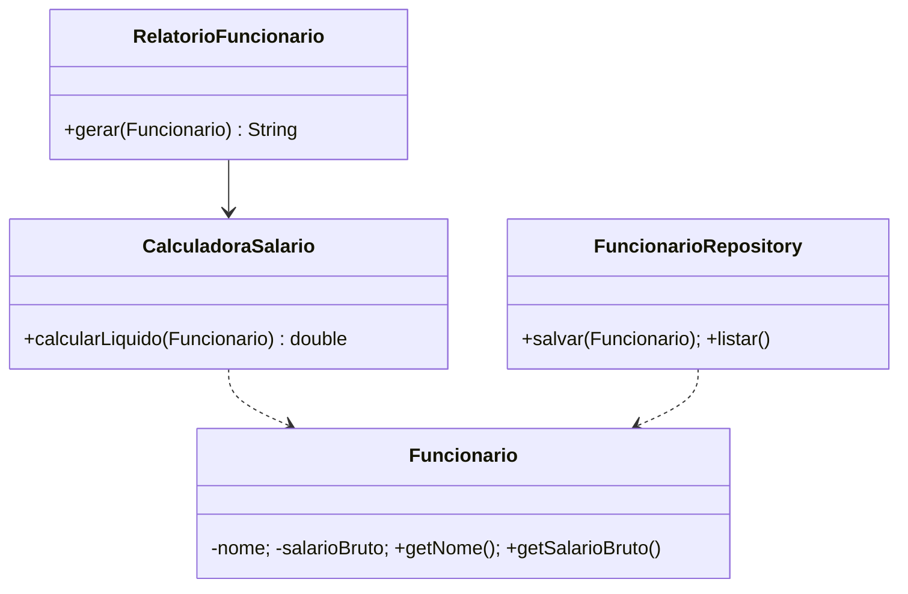
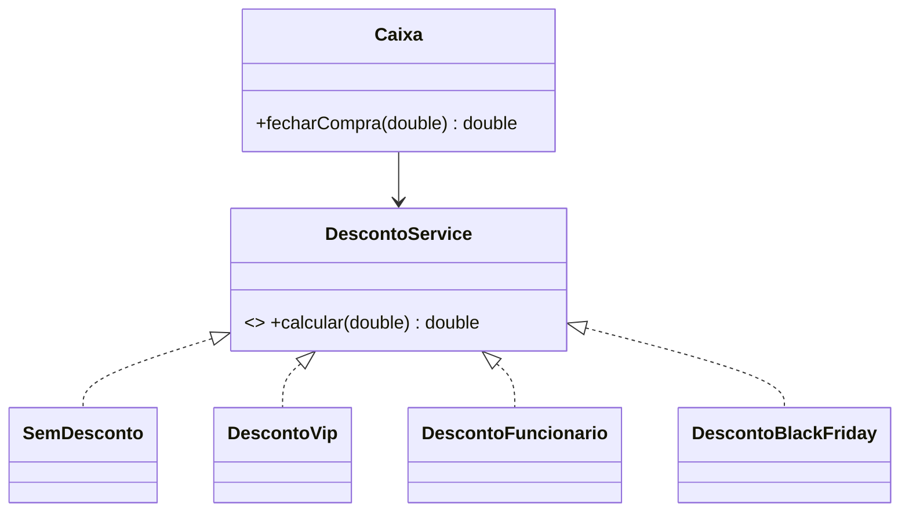
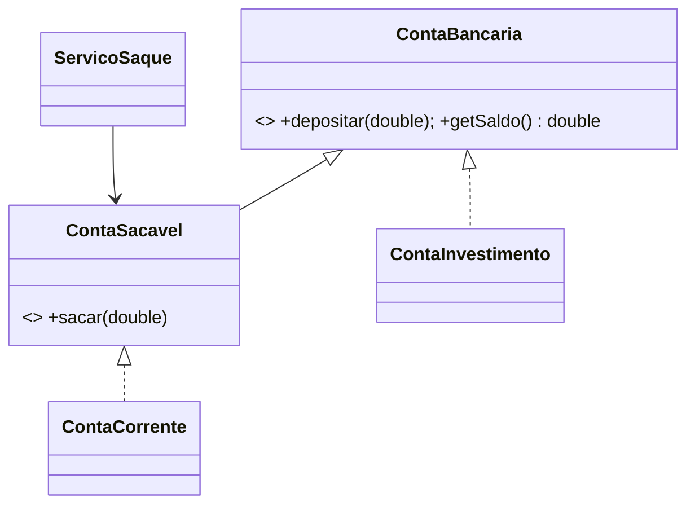
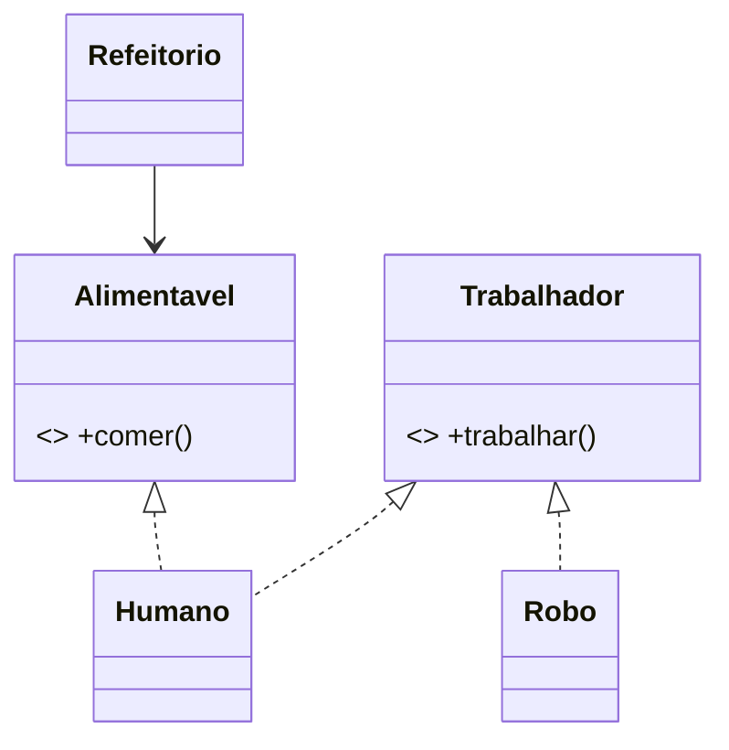
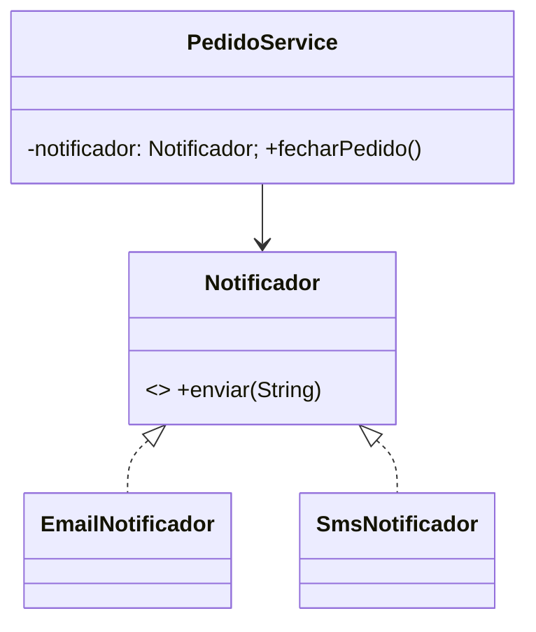

# Princípios SOLID com Java e JUnit

**Centro Universitário Unibras - Montes Belos** · Engenharia de Software · 6º Período · 2026/2  
**Disciplina:** Arquitetura e Projeto de Software · **Professor:** Henrique Santiago  
**Aluno:** Hafrannio Filho Menezes Rodrigues  
**Entrega:** 16/11/2026 · **Modalidade:** Individual

## 1. Como executar

Requisitos: **Java 17 ou superior** (desenvolvido e testado com Java 21). Não é preciso instalar o Maven: o projeto traz o Maven Wrapper (`mvnw`).

```bash
# Linux / macOS / Git Bash
./mvnw test          # compila e executa os testes JUnit 5
./mvnw compile exec:java   # roda a demonstração (classe br.edu.unibras.solid.Main)
```

```powershell
# Windows (PowerShell / CMD)
.\mvnw.cmd test
.\mvnw.cmd compile exec:java
```

Com o Maven instalado, basta trocar `./mvnw` por `mvn`.

## 2. Estrutura do projeto

Cada princípio fica em um pacote próprio, com o código que **viola** o princípio e a versão **refatorada** lado a lado:

```
src/main/java/br/edu/unibras/solid/
├── Main.java                 # demonstração das versões refatoradas
├── srp/ {violacao, refatorado}
├── ocp/ {violacao, refatorado}
├── lsp/ {violacao, refatorado}
├── isp/ {violacao, refatorado}
└── dip/ {violacao, refatorado}
src/test/java/br/edu/unibras/solid/
├── srp/SrpTest.java
├── ocp/DescontoTest.java
├── lsp/LiskovTest.java
├── isp/RoboTest.java
└── dip/PedidoServiceTest.java
```

Os testes cobrem os dois lados: provam o **problema** na versão com violação (por exemplo, a exceção que estoura no cliente) e o **comportamento correto** da versão refatorada. Resultado atual: **19 testes, 0 falhas**.

## 3. Fundamentação teórica

**SOLID** é um acrônimo reunido por Robert C. Martin (“Uncle Bob”) no início dos anos 2000 para cinco princípios de projeto orientado a objetos. O termo foi cunhado por Michael Feathers. O objetivo comum é produzir código **fácil de mudar**: com alta coesão, baixo acoplamento e dependências apontando para abstrações estáveis (MARTIN, 2017; ANICHE, 2016).

A motivação é econômica. O custo de um software está mais na manutenção do que na escrita inicial. Classes que fazem muitas coisas, que precisam ser editadas a cada nova regra ou que conhecem detalhes concretos de outras classes tornam cada mudança arriscada. Os princípios SOLID atacam esses sintomas, que Martin chama de rigidez, fragilidade e imobilidade. Eles se apoiam mutuamente: aplicar o SRP gera classes pequenas, que facilitam o OCP; o OCP depende de abstrações, que são justamente o que o DIP pede; o LSP garante que essas abstrações sejam confiáveis; e o ISP evita que elas fiquem grandes demais.

Os princípios também facilitam os **testes**. Código desacoplado pode ser testado em isolamento, trocando dependências reais por dublês. É o que se vê nos testes JUnit deste projeto, sobretudo no DIP (CASA DO CÓDIGO, TDD).

### S - Single Responsibility Principle (Responsabilidade Única)

> “Uma classe deve ter um, e apenas um, motivo para mudar.” (MARTIN)

**Responsabilidade** aqui significa **motivo para mudar**, ou, na formulação de *Clean Architecture*, um **ator** (um grupo de pessoas interessadas) que pede mudanças. Quando uma classe atende a vários atores, a mudança pedida por um pode quebrar o que outro usa.

- **Violação** (`srp.violacao.Funcionario`): a mesma classe calcula o salário (RH/financeiro), grava em um “banco” (infraestrutura) e formata o relatório (apresentação). Para testar o cálculo é preciso carregar junto o estado global de persistência.
- **Refatoração** (`srp.refatorado`): `Funcionario` só guarda dados; `CalculadoraSalario` tem a regra; `FuncionarioRepository` persiste; `RelatorioFuncionario` formata. Cada classe muda por um único motivo.



### O - Open/Closed Principle (Aberto/Fechado)

> “Entidades de software devem estar abertas para extensão, mas fechadas para modificação.” (MEYER, 1988; MARTIN)

O comportamento novo deve entrar por **código novo**, como uma nova classe que implementa uma abstração, e não pela edição de código já testado. Em Java, isso se faz com **polimorfismo** (interfaces e classes abstratas).

- **Violação** (`ocp.violacao.CalculadoraDesconto`): uma cadeia de `if` por tipo de cliente. Para criar o desconto de *Black Friday* é preciso abrir a classe; o teste mostra que, sem essa edição, o tipo novo lança exceção.
- **Refatoração** (`ocp.refatorado`): a interface `DescontoService` e as implementações `SemDesconto`, `DescontoVip` e `DescontoFuncionario`. Depois, `DescontoBlackFriday` foi **adicionado sem tocar** em `Caixa` nem nas outras classes. Até uma *lambda* serve como extensão.



### L - Liskov Substitution Principle (Substituição de Liskov)

> “Se S é subtipo de T, objetos do tipo T podem ser substituídos por objetos do tipo S sem alterar as propriedades desejáveis do programa.” (LISKOV, 1987)

Herdar não basta: o subtipo precisa **respeitar o contrato** do tipo base. Ele não pode exigir pré-condições mais fortes, entregar pós-condições mais fracas nem lançar exceções que o cliente não espera. O sinal clássico de violação é um método sobrescrito que lança `UnsupportedOperationException`, ou um `instanceof` no cliente para “tratar o caso especial”.

- **Violação** (`lsp.violacao`): `ContaInvestimento extends ContaBancaria`, mas sobrescreve `sacar()` para lançar exceção. `ServicoSaque`, escrito para `ContaBancaria`, quebra ao receber o subtipo; o teste `violacaoSubclasseQuebraClienteDaBase` demonstra isso.
- **Refatoração** (`lsp.refatorado`): o contrato foi dividido. `ContaBancaria` (depositar e consultar saldo) é cumprido por todas as contas; `ContaSacavel` só por quem saca de fato (`ContaCorrente`). `ContaInvestimento` (depósito com rendimento de 2%) implementa apenas `ContaBancaria`, e `ServicoSaque` passa a aceitar só `ContaSacavel`. O compilador impede a substituição inválida.



### I - Interface Segregation Principle (Segregação de Interfaces)

> “Clientes não devem ser forçados a depender de métodos que não utilizam.” (MARTIN)

Interfaces “gordas” obrigam as implementações a fornecer métodos sem sentido, geralmente vazios ou que lançam exceção. Isso leva direto a violações de LSP. A solução é dividir a interface em **papéis** pequenos e coesos.

- **Violação** (`isp.violacao`): `Trabalhador` exige `trabalhar()` e `comer()`, e `Robo` é forçado a implementar `comer()` lançando exceção. O `Refeitorio` quebra ao servir uma equipe que inclui um robô.
- **Refatoração** (`isp.refatorado`): `Trabalhador` e `Alimentavel` passam a ser interfaces separadas. `Humano` implementa as duas e `Robo` só `Trabalhador`. `Refeitorio` aceita `List<? extends Alimentavel>`, então nem compila se recebe um robô.



### D - Dependency Inversion Principle (Inversão de Dependência)

> “Módulos de alto nível não devem depender de módulos de baixo nível. Ambos devem depender de abstrações. Abstrações não devem depender de detalhes; detalhes devem depender de abstrações.” (MARTIN)

A regra de negócio (alto nível) define a **abstração de que precisa**, e a infraestrutura (baixo nível) a implementa. A dependência no código-fonte fica, assim, *invertida* em relação ao fluxo de controle. Na prática, isso se aplica com **injeção de dependência** pelo construtor.

- **Violação** (`dip.violacao.PedidoService`): faz `new EmailNotificador()` internamente. Para trocar por SMS é preciso editar a classe, e o teste tem de inspecionar a implementação concreta.
- **Refatoração** (`dip.refatorado`): `PedidoService` recebe um `Notificador` (interface) pelo construtor. `EmailNotificador` e `SmsNotificador` são detalhes plugáveis, e no teste o notificador é substituído por uma *lambda* (*mock*), sem nenhuma biblioteca extra.



## 4. Considerações finais

Os princípios SOLID não são regras para aplicar mecanicamente em todo lugar. Cada abstração tem um custo (mais classes, mais indireção), e aplicá-los em excesso gera *over-engineering*. A recomendação de Martin e de Aniche é aplicá-los **onde existe pressão real de mudança**: regras que variam, integrações que podem ser trocadas, código que precisa ser testado em isolamento. Nos exemplos deste projeto, cada refatoração resolve um problema concreto que os testes da versão com violação tornam visível.

## 5. Referências

- SILVA, Maurício Aniche. *Desbravando o SOLID: princípios da programação orientada a objetos*. São Paulo: Casa do Código, 2016. Disponível em: https://www.casadocodigo.com.br/products/livro-desbravando-solid.
- SOARES, Rodrigo. *Orientação a Objetos e SOLID para Microsserviços*. São Paulo: Casa do Código. Disponível em: https://www.casadocodigo.com.br/products/livro-oo-solid.
- CASA DO CÓDIGO. *TDD: Test-Driven Development na prática*. São Paulo: Casa do Código. Disponível em: https://www.casadocodigo.com.br/products/livro-tdd.
- MARTIN, Robert C. *Clean Code: A Handbook of Agile Software Craftsmanship*. Boston: Prentice Hall, 2008.
- MARTIN, Robert C. *Clean Architecture: A Craftsman's Guide to Software Structure and Design*. Boston: Prentice Hall, 2017.
- LISKOV, Barbara. *Data Abstraction and Hierarchy*. OOPSLA '87 Addendum, 1987.
- MEYER, Bertrand. *Object-Oriented Software Construction*. Prentice Hall, 1988.
- DESCHAMPS, Filipe. *SOLID is EASY with These Illustrations*. YouTube, 2020. Disponível em: https://www.youtube.com/watch?v=6SfrO3D4dHM.
- YOUTUBE. *Vídeo Complementar sobre SOLID (I)*. Disponível em: https://www.youtube.com/watch?v=_jDNAf3CzeY.
- YOUTUBE. *Vídeo Complementar sobre SOLID (II)*. Disponível em: https://www.youtube.com/watch?v=f6-5ANuTkys.
- YOUTUBE. *Vídeo Complementar sobre SOLID (III)*. Disponível em: https://www.youtube.com/watch?v=T6pF7BfAPIo.
